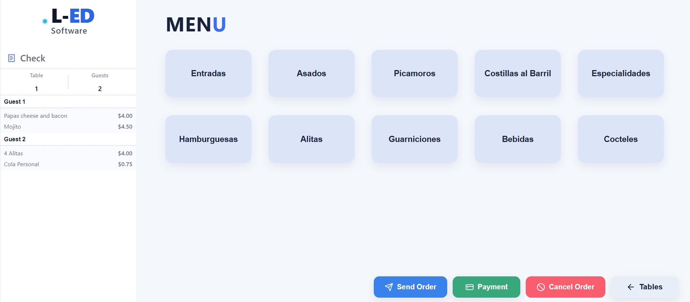

# Residente POS

Full-stack Restaurant Point-of-Sale (POS) system designed to manage
restaurant tables, guests, orders, menu items, and payment workflows.

The project integrates a React frontend with a Python/FastAPI REST API
and a PostgreSQL relational database.

## Tech Stack

### Frontend
- React
- JavaScript
- Vite
- CSS

### Backend
- Python
- FastAPI
- SQLAlchemy
- REST APIs

### Database
- PostgreSQL
- Relational database design
- Foreign key relationships
- SQL queries and data validation

Tech Stack
Frontend
React
JavaScript
Vite
CSS
Backend
Python
FastAPI
SQLAlchemy
REST APIs
Database
PostgreSQL
Relational database design
Foreign key relationships
SQL queries and data validation
Features
Table availability and occupancy management
Guest management
Database-driven menu and product categories
Order creation and management
Pending and sent order-item workflows
Move items between guests
Partial and full item voids
Order cancellation
Payment validation and order closure
Business-rule and data-integrity validations
System Architecture
React Frontend ↓ REST API ↓ Python / FastAPI ↓ SQLAlchemy ↓ PostgreSQL

- Table availability and occupancy management
- Guest management
- Database-driven menu and product categories
- Order creation and management
- Pending and sent order-item workflows
- Move items between guests
- Partial and full item voids
- Order cancellation
- Payment validation and order closure
- Business-rule and data-integrity validations

## System Architecture

React Frontend
        ↓
    REST API
        ↓
 Python / FastAPI
        ↓
    SQLAlchemy
        ↓
   PostgreSQL

## Database Structure

The system uses a relational PostgreSQL database with the following
main entities:

- Categories
- Products
- Orders
- Order Guests
- Order Items

Relationships are managed using primary and foreign keys to maintain
data integrity throughout the order lifecycle.

## Project Status

🚧 Currently under active development.

Current development focuses on expanding payment functionality,
reporting capabilities, and additional restaurant-management features.

### Table Management

### Order & Menu Management

### Order Details

Project Status
🚧 Currently under active development.

Current development focuses on expanding payment functionality, reporting capabilities, and additional restaurant-management features.

Author
Luis Bravo Moreno