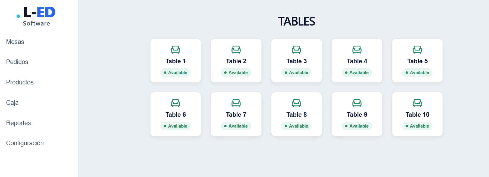
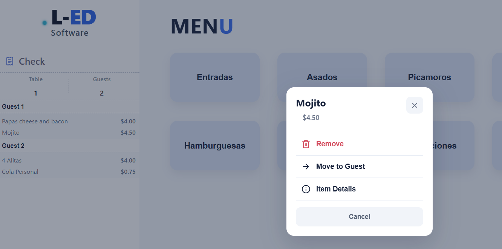
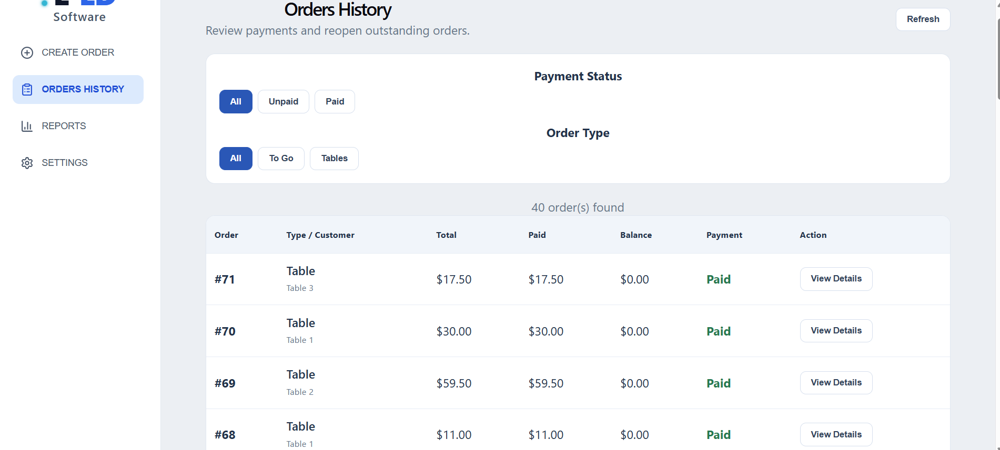
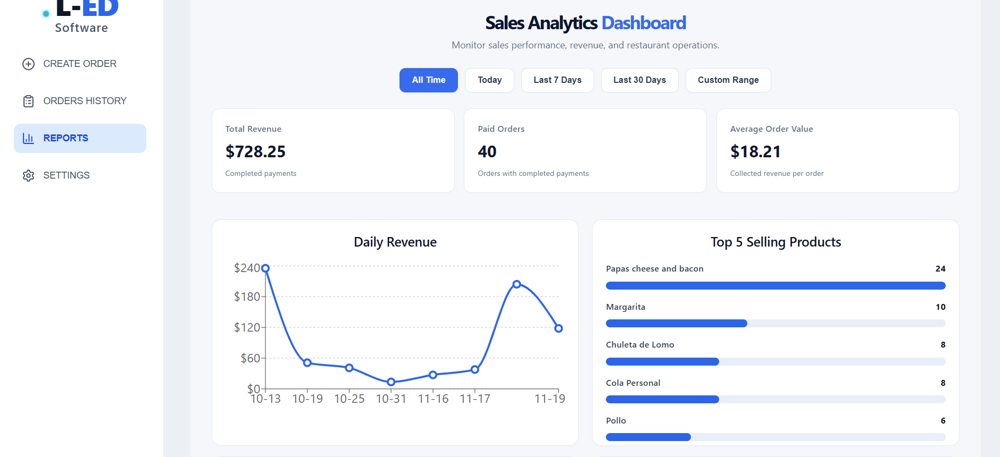

# RESIDENTE POS

### Restaurant Point-of-Sale & Sales Analytics System

RESIDENTE POS is a full-stack restaurant management application designed to streamline daily operations, manage customer orders, process payments, and analyze sales performance.

The application combines a **React frontend**, a **Python/FastAPI REST API**, and a **PostgreSQL relational database**.

The project also includes a **Sales Analytics Dashboard** that transforms transactional data into meaningful business insights.

**Project Type:** Full-Stack Web Application  
**Project Status:** Active Development

---

## Tech Stack

### Frontend
- React
- JavaScript
- Vite
- CSS
- Recharts

### Backend
- Python
- FastAPI
- SQLAlchemy
- REST APIs

### Database
- PostgreSQL
- Relational database design
- SQL queries and aggregations
- Primary and foreign key relationships

### Development Tools
- Git & GitHub
- Visual Studio Code
- FastAPI Swagger UI

---

## Core Features

### 1. Table & Guest Management
- Table availability and occupancy management
- Dine-in and takeout order creation
- Multiple guests per order
- Guest-specific item management


### 2. Order Management
- Database-driven menu and product categories
- Pending and sent order-item workflows
- Kitchen order submission
- Moving items between guests
- Partial and full item voids
- Order cancellation
- Business-rule and data-integrity validations



### 3. Payment Processing
- Cash payment processing
- Partial and full payments
- Outstanding balance calculation
- Automatic change calculation
- Automatic order closure after full payment
- Payment-related business-rule validations

### 4. Order History & Receipts
- Order history management
- Kitchen receipts
- Customer receipts
- Thermal receipt formatting

---

## Sales Analytics Dashboard

The **Sales Analytics Dashboard** provides an interactive interface for monitoring restaurant performance using transactional data retrieved from PostgreSQL.

The reporting module uses **FastAPI, SQLAlchemy, PostgreSQL, React, and Recharts** to calculate and visualize key business metrics.




### Key Performance Indicators (KPIs)

- **Total Revenue:** Revenue collected from completed payments.
- **Paid Orders:** Number of distinct orders with completed payments.
- **Average Order Value (AOV):** Total revenue divided by the number of paid orders.

### Data Visualizations

#### Daily Revenue
- Interactive line chart displaying daily revenue trends.
- Revenue calculated from completed payment transactions.

#### Top 5 Selling Products
- Ranking of the five best-selling products.
- Product-level quantity and revenue aggregations.

#### Revenue by Payment Method
- Donut chart displaying revenue distribution by payment method.
- Visual comparison of cash and card payment categories.

#### Sales Summary
- Operational sales metrics.
- Order activity and product quantity summaries.
- Additional aggregated restaurant performance indicators.

### Date Filtering

The dashboard supports the following filters:

- **All Time**
- **Today**
- **Last 7 Days**
- **Last 30 Days**
- **Custom Date Range**

All reporting endpoints accept optional `start_date` and `end_date` query parameters.

Date filtering is implemented using the **America/New_York** timezone to ensure accurate daily reporting and account for daylight saving time.

### Reporting API Endpoints

| Method | Endpoint | Description |
|--------|----------|-------------|
| GET | `/reports/summary` | Revenue, paid orders, and average order value |
| GET | `/reports/daily-revenue` | Daily revenue aggregation |
| GET | `/reports/top-products` | Top-selling products |
| GET | `/reports/payment-methods` | Revenue grouped by payment method |
| GET | `/reports/sales-summary` | Operational sales metrics |

**Example API Request:**

```http
GET /reports/summary?start_date=2026-11-01&end_date=2026-11-19
```

---

## System Architecture

```text
             React Frontend
                   |
                   | HTTP / REST API
                   v
             Python / FastAPI
                   |
                   | SQLAlchemy ORM
                   v
            PostgreSQL Database
                   |
                   v
           Transactional Data
                   |
                   v
          Sales Analytics API
                   |
                   v
          React / Recharts
```

The frontend communicates with FastAPI through REST endpoints.

The backend handles order processing, payment validation, database transactions, and analytical queries.

SQLAlchemy manages database interactions, while PostgreSQL stores transactional and operational data.

The reporting module aggregates transactional records and returns structured JSON responses for visualization.

---

## Database Structure

The system uses a relational PostgreSQL database.

### Main Tables

| Table | Description |
|-------|-------------|
| `categories` | Restaurant product categories |
| `products` | Menu items and pricing |
| `orders` | Customer orders |
| `order_guests` | Guests associated with orders |
| `order_items` | Ordered products and item statuses |
| `payments` | Payment transactions |
| `restaurant_settings` | Restaurant configuration |

Relationships are maintained through **primary and foreign keys** to support referential integrity throughout the order lifecycle.

---

## Data Analytics & SQL

The reporting module uses PostgreSQL queries and SQLAlchemy to calculate business performance metrics.

### Implemented Analytical Techniques

- SQL JOIN operations
- GROUP BY aggregations
- SUM and COUNT
- COUNT DISTINCT
- Date-based filtering
- Revenue calculations
- Product rankings
- Payment method analysis
- Timezone-aware date aggregation

These techniques transform transactional data into measurable business indicators.

---

## Project Status

🚧 **Currently under active development.**

### Implemented Features

- Table and guest management
- Dine-in and takeout orders
- Order-item management
- Kitchen order workflows
- Partial and full cash payments
- Order history
- Kitchen and customer receipt components
- Sales Analytics Dashboard
- Date-based reporting
- Timezone-aware analytics

### Planned Improvements

- Advanced split-payment functionality
- Additional payment methods
- CSV report exports
- Expanded analytics capabilities
- Frontend component refactoring
- Production deployment and configuration

---

## Author

**Luis Bravo Moreno**

**Telematics Engineer | Python | Full-Stack Development | Data Analytics**

Developed as a practical software engineering and data analytics portfolio project.